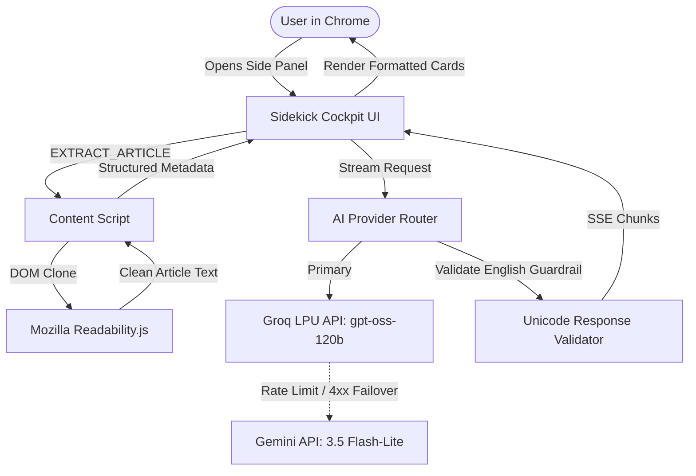

# Sidekick — AI Browser Copilot ⚡

> **A privacy-first, human-in-the-loop Chrome side-panel AI agent that reads, understands, and safely acts on web pages in English.**

[](https://developer.chrome.com/docs/extensions/mv3/intro/)
[-F05A28?logo=groq&logoColor=white)](https://groq.com/)
[](https://aistudio.google.com/)
[](LICENSE)

---

## 🌟 Overview

**Sidekick** is an intelligent browser copilot living in Chrome's native Side Panel. Unlike legacy browser extensions that scrape DOM elements indiscriminately or dump raw web text into cloud LLMs, Sidekick implements a **privacy-first, local extraction pipeline** using Mozilla's `Readability.js`.

It runs on **Groq's LPUs** (`openai/gpt-oss-120b`) for near-zero latency inference with zero safety-filter blockage, backed by an automated fallback router to **Google AI Studio's Gemini 3.5 Flash-Lite**.

---

## 🚀 Key Features (Phase 1: "The Eyes — Read the Web")

### 1. Dual-Engine AI Routing
* **Primary**: Groq LPU (`openai/gpt-oss-120b`) delivering blazing-fast, streaming completions without false-positive safety refusals.
* **Fallback**: Google AI Studio (`gemini-3.5-flash-lite`) configured as an automated backup if rate limits or network issues occur.
* **Auto-Failover**: Integrated `ai_router.js` handles retries and provider transitions transparently.

### 2. Clutter-Free Local Article Extraction
* Bundled **Mozilla `Readability.js`** parses article text, metadata, word counts, and estimated reading time directly on-device.
* Automatically strips tracking scripts, advertisement iframes, and navigational noise before sending clean text to the model.

### 3. Structured English Summaries
* **⚡ One-Line TL;DR**: A single high-impact thesis statement.
* **💡 5 Key Takeaways**: Bulleted core facts, hardware/algorithmic milestones, and data points.
* **🎯 What To Do Next**: Actionable next steps for research, engineering, or workflow adoption.
* **📋 Copy to Clipboard**: One-click export with instant toast confirmation.
* **Toggle Modes**: Switch between **Concise** (5 bullets) and **Detailed** (comprehensive analysis).

### 4. Grounded In-Page Chat
* Ask questions about complex terms, data, or arguments on the active webpage.
* Built-in grounding directives instruct the model to answer strictly from the page content and explicitly state when information is absent.
* Real-time Server-Sent Events (SSE) streaming with an interactive typing cursor.

### 5. Deterministic English-Only Guardrail
* System-level English directives ensure the assistant reasons and outputs exclusively in clear English.
* Code-level Unicode validator (`/[\u0900-\u097F]/`) blocks and auto-corrects foreign language drift.

### 6. Zero-Leak Local Privacy
* API credentials and profile settings reside exclusively inside `chrome.storage.local`.
* No intermediary backend servers or telemetry collection.

---

## 🏗️ Architecture



---

## 📂 Project Structure

```text
sidekick/
├── manifest.json              # Chrome Manifest V3 configuration
├── icons/                     # Extension icons (16, 32, 48, 128px)
├── src/
│   ├── background/
│   │   └── service_worker.js  # Lifecycle manager & multi-key verification
│   ├── content/
│   │   ├── readability.js     # Bundled Mozilla Readability
│   │   └── content_script.js  # In-page DOM extractor & fallback
│   ├── sidepanel/
│   │   ├── sidepanel.html     # Tabbed Cockpit UI (Chat, Summary, Settings)
│   │   ├── sidepanel.css      # Dark-mode design system & glassmorphism
│   │   ├── sidepanel.js       # Main side panel controller
│   │   └── components/
│   │       └── summary_view.js# Summary controller & card renderer
│   ├── ai/
│   │   ├── ai_router.js       # Groq primary + Gemini fallback router
│   │   ├── groq_client.js     # Groq SSE streaming client
│   │   ├── gemini_client.js   # Gemini REST client
│   │   ├── prompt_templates.js# Structured prompts & English directives
│   │   └── response_validator.js# Unicode Devanagari guardrail
│   └── shared/
│       └── storage_utils.js   # Chrome Storage Local & Session utilities
├── demo/
│   └── sample_article.html    # Standalone test article fixture
├── scripts/
│   ├── run_dev.py             # Persistent local test server & Chrome launcher
│   ├── test_slice3.py         # Automated extraction & summary test suite
│   └── test_groq_primary.py   # Groq & Gemini live endpoint verification
├── .env.example               # Template for API keys
├── .gitignore                 # Strict rules protecting credentials & venv
└── README.md                  # Project documentation
```

---

## 🛠️ Quick Start & Installation

### Prerequisites
* Google Chrome (Version 116+ recommended for native Side Panel support).
* Free API Keys:
  * **Groq API Key** (Primary): [console.groq.com/keys](https://console.groq.com/keys)
  * **Google AI Studio Key** (Fallback): [aistudio.google.com/app/apikey](https://aistudio.google.com/app/apikey)

### 1. Clone the Repository
```bash
git clone https://github.com/Niklaus2003/sidekick.git
cd sidekick
```

### 2. Load the Extension in Chrome
1. Open Google Chrome and navigate to `chrome://extensions`.
2. Toggle **Developer mode** to **ON** in the top-right corner.
3. Click the **"Load unpacked"** button in the top-left corner.
4. Select the `sidekick` root folder.
5. In Chrome's toolbar, click the **puzzle icon 🧩** and pin **Sidekick ⚡**.

### 3. Configure API Credentials
1. Click the **Sidekick ⚡** icon in the toolbar to slide open the side panel.
2. Navigate to the **Settings** tab.
3. Enter your **Groq API Key** and **Gemini API Key**.
4. Click **"Test Connections"** — verify that both services report active connection.
5. Click **"Save Keys"**.

---

## 🧪 Testing with the Local Demo Article

A built-in test server and sample article are included for offline validation:

```powershell
# Launch the persistent test server
python scripts/run_dev.py
```

1. Navigate to: `http://127.0.0.1:8765/demo/sample_article.html`.
2. Open Sidekick in the side panel.
3. Switch to the **Summary** tab and click **"✨ Summarize Current Page"**.
4. Observe the clean Readability extraction, metadata badges, and streaming summary.
5. Switch to the **Chat** tab and ask:
   > *"What makes in-browser agent architectures different from cloud chat interfaces?"*

---

## 🔬 Automated Test Suites

Run the automated verification scripts using Python:

```bash
# Verify Groq primary inference and Gemini fallback standby
python scripts/test_groq_primary.py

# Verify Readability extraction, manifest paths, and structured prompt formatting
python scripts/test_slice3.py
```

---

## 🗺️ Roadmap

- [x] **Phase 1: The Eyes (Week 1)** — MV3 side panel foundation, Mozilla Readability integration, Groq LPU primary inference, Gemini fallback router, and structured English summaries.
- [ ] **Phase 2: The Brain (Week 2)** — Multimodal visual inspection (screenshots), YouTube transcript chaptering, and context-menu quick explainers.
- [ ] **Phase 3: The Hands (Week 3)** — Interactive element scanning, isolated badge overlays, and approval-based human-in-the-loop task execution.
- [ ] **Phase 4: Memory & Safety (Week 4)** — Local profile memory vault, saved workflow recipes, and action dry-run simulators.

---

## 📄 License

Distributed under the MIT License. See `LICENSE` for details.
