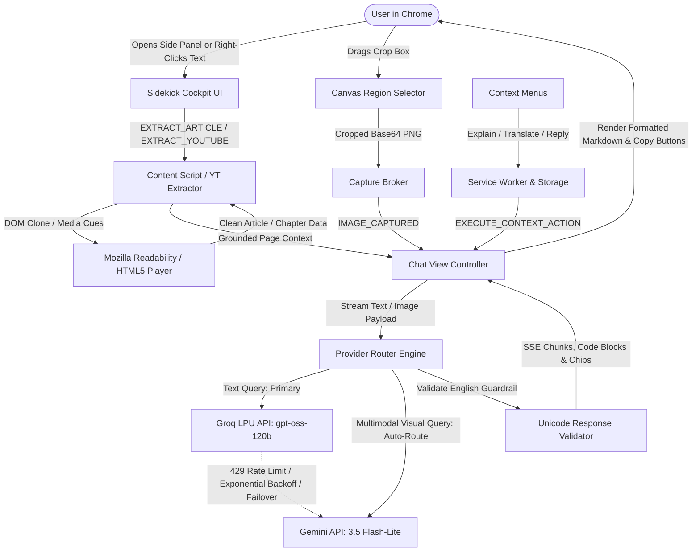

# Sidekick — AI Browser Copilot ⚡

> **A privacy-first, human-in-the-loop Chrome side-panel AI agent that reads, understands, and safely acts on web pages in English.**

[](https://developer.chrome.com/docs/extensions/mv3/intro/)
[-F05A28?logo=groq&logoColor=white)](https://groq.com/)
[](https://aistudio.google.com/)
[](LICENSE)

---

## 🌟 Overview

**Sidekick** is an intelligent browser copilot living in Chrome's native Side Panel. Unlike legacy browser extensions that scrape DOM elements indiscriminately or dump raw web text into cloud LLMs, Sidekick implements a **privacy-first, local extraction pipeline** using Mozilla's `Readability.js`.

It runs on **Groq's LPUs** (`openai/gpt-oss-120b`) for near-zero latency inference with zero safety-filter blockage, backed by an automated fallback router to **Google AI Studio's Gemini 3.5 Flash-Lite**.

---

## 🚀 Key Features (Phase 1: "The Eyes — Read the Web")

### 1. Dual-Engine AI Routing
* **Primary**: Groq LPU (`openai/gpt-oss-120b`) delivering blazing-fast, streaming completions without false-positive safety refusals.
* **Fallback**: Google AI Studio (`gemini-3.5-flash-lite`) configured as an automated backup if rate limits or network issues occur.
* **Auto-Failover**: Integrated `ai_router.js` handles retries and provider transitions transparently.

### 2. Clutter-Free Local Article Extraction
* Bundled **Mozilla `Readability.js`** parses article text, metadata, word counts, and estimated reading time directly on-device.
* Automatically strips tracking scripts, advertisement iframes, and navigational noise before sending clean text to the model.

### 3. Structured English Summaries
* **⚡ One-Line TL;DR**: A single high-impact thesis statement.
* **💡 5 Key Takeaways**: Bulleted core facts, hardware/algorithmic milestones, and data points.
* **🎯 What To Do Next**: Actionable next steps for research, engineering, or workflow adoption.
* **📋 Copy to Clipboard**: One-click export with instant toast confirmation.
* **Toggle Modes**: Switch between **Concise** (5 bullets) and **Detailed** (comprehensive analysis).

### 4. Public YouTube Summarizer & Interactive Seeking (Slice 4)
* **Automatic YouTube Detection**: Detects watch pages (`/watch`, `/live`) and switches into chaptering mode (`🎬 Summarize Video Chapters`).
* **Metadata & Cue Extraction**: Injects `youtube_extractor.js` to extract video title, channel, description, chapters, and timed transcript cues.
* **Interactive Timestamp Seekers**: Generates clickable `[MM:SS]` timestamp chips. Clicking any timestamp immediately jumps the active YouTube video to that precise second with instant visual toast feedback.

### 5. English-Only Guardrail & Summary Controls (Slice 5)
* **Concise vs. Detailed Toggles**: Switch between **Concise** (fast 1-line TL;DR + 5 key takeaways) and **Detailed** (comprehensive 8–10 point in-depth breakdown).
* **Multilingual Input Translation**: Automatically detects non-English source material (Hindi, French, Spanish, German, Japanese, etc.) and synthesizes 100% fluent English summaries.
* **Deterministic Guardrail**: Validates generated tokens against Devanagari Unicode (`/[\u0900-\u097F]/`), preventing foreign-script leakage.

### 6. Grounded In-Page Chat (Slice 6)
* **Active Page Grounding**: Reads the active browser tab via Mozilla Readability to anchor all answers strictly in page content.
* **Anti-Hallucination Guardrail**: If asked an unlisted or unrelated question (e.g. general trivia not on page), Sidekick explicitly responds: *"This page does not contain that information."* in English.
* **Rich Markdown & Code Block Copy**: Real-time streaming with markdown headers, lists, bold/italics, and formatted syntax blocks featuring language tags and one-click **"📋 Copy"** buttons.
* **Message Copy**: One-click clipboard copy for complete AI response bubbles.

### 7. Right-Click Context-Menu Quick Actions (Slice 7)
* **Browser Right-Click Integration**: Registers 3 native Chrome context menu actions for highlighted text (`selection`):
  1. `📖 Sidekick: Explain this in plain English` (ELI5 simple English explanation).
  2. `🌐 Sidekick: Translate to English` (translates non-English text cleanly into 100% English).
  3. `✉️ Sidekick: Draft a professional reply` (generates Concise & Collaborative response options).
* **Automated Side Panel Routing**: Clicking any context action auto-opens the side panel, focuses the Chat tab, and streams the result.

### 8. Screenshot Capture & Multimodal Visual Q&A (Slice 8)
* **In-Page Region Selector**: Built-in canvas overlay (`region_selector.js`) lets users drag-and-drop a rectangular crop box over charts, graphs, or UI tables with live dimension indicators and `Escape` key cancel.
* **Full-Tab Capture Broker**: `capture_broker.js` orchestrates `chrome.tabs.captureVisibleTab(null, { format: 'png' })` without external screenshot services.
* **Thumbnail Chat Attachment**: Displays an interactive attachment preview card with a cancel button above the input bar and renders high-contrast screenshot badges directly within user message bubbles.
* **Gemini 3.5 Flash-Lite Multimodal Analysis**: Routes screenshot payloads with base64 `inlineData` directly to Gemini Flash for rapid visual reasoning in 100% fluent English.

### 9. Free-Tier 429 Resilience & Provider Fallback Router (Slice 9)
* **Exponential Backoff**: Intercepts HTTP `429 Too Many Requests` or quota exhaustion warnings with an automated backoff retry (1s, 2s).
* **Automated Provider Failover**: If the primary engine is throttled or down, `provider_router.js` seamlessly routes queries to the fallback provider without crashing the side panel or dropping state.
* **Multimodal Auto-Routing**: Automatically directs image payloads to Gemini 3.5 Flash-Lite (multimodal-capable) while keeping text queries on ultra-fast Groq LPUs.
* **Non-Intrusive UI Warning Banners**: Displays a subtle warning banner in the side panel when operating on fallback inference, keeping users informed.

### 10. Zero-Leak Local Privacy
* API credentials and profile settings reside exclusively inside `chrome.storage.local`.
* No intermediary backend servers or telemetry collection.

---

## 🏗️ Architecture



---

## 📂 Project Structure

```text
sidekick/
├── docs/                      # Architecture, implementation plan, problem statement
├── manifest.json              # Chrome Manifest V3 configuration (sidePanel, contextMenus, regionSelector)
├── icons/                     # Extension icons (16, 32, 48, 128px)
├── src/
│   ├── background/
│   │   ├── service_worker.js  # Lifecycle manager & multi-key verification
│   │   ├── context_menus.js   # Browser right-click selection actions (Slice 7)
│   │   └── capture_broker.js  # Tab capture & region crop broker (Slice 8)
│   ├── content/
│   │   ├── readability.js     # Bundled Mozilla Readability
│   │   ├── content_script.js  # In-page DOM extractor & fallback
│   │   ├── youtube_extractor.js # YouTube metadata, cue reader & video seeker
│   │   └── region_selector.js # Interactive canvas screenshot crop overlay (Slice 8)
│   ├── sidepanel/
│   │   ├── sidepanel.html     # Tabbed Cockpit UI (Chat, Summary, Settings)
│   │   ├── sidepanel.css      # Dark-mode design system & glassmorphism
│   │   ├── sidepanel.js       # Main side panel controller
│   │   └── components/
│   │       ├── summary_view.js# Summary controller, seek chips & card renderer
│   │       └── chat_view.js   # Grounded chat, screenshot preview & context actions
│   ├── ai/
│   │   ├── ai_router.js       # AI router entry point
│   │   ├── provider_router.js # Resilience engine, 429 backoff & auto-failover (Slice 9)
│   │   ├── groq_client.js     # Groq SSE streaming client
│   │   ├── gemini_client.js   # Gemini REST & Multimodal client
│   │   ├── prompt_templates.js# Grounded chat, YouTube chapters & quick action prompts
│   │   └── response_validator.js# Unicode Devanagari guardrail & JSON parser
│   └── shared/
│       └── storage_utils.js   # Chrome Storage Local & Session utilities
├── demo/
│   └── sample_article.html    # Standalone test article fixture
├── scripts/
│   ├── run_dev.py             # Persistent local test server & Chrome launcher
│   ├── test_slice3.py         # Automated extraction & summary test suite
│   ├── test_slices_4_5.py     # YouTube chapter extraction & English guardrail suite
│   ├── test_slices_6_7.py     # Grounded chat & context-menu quick action suite
│   ├── test_slices_8_9.py     # Multimodal visual Q&A & 429 fallback engine suite
│   ├── test_live_samples.py   # Real article & YouTube video chapter test suite
│   └── test_groq_primary.py   # Groq & Gemini live endpoint verification
├── .env.example               # Template for API keys
├── .gitignore                 # Strict rules protecting credentials & venv
└── README.md                  # Project documentation
```

---

## 🛠️ Quick Start & Installation

### Prerequisites
* Google Chrome (Version 116+ recommended for native Side Panel support).
* Free API Keys:
  * **Groq API Key** (Primary): [console.groq.com/keys](https://console.groq.com/keys)
  * **Google AI Studio Key** (Fallback): [aistudio.google.com/app/apikey](https://aistudio.google.com/app/apikey)

### 1. Clone the Repository
```bash
git clone https://github.com/Niklaus2003/sidekick.git
cd sidekick
```

### 2. Load the Extension in Chrome
1. Open Google Chrome and navigate to `chrome://extensions`.
2. Toggle **Developer mode** to **ON** in the top-right corner.
3. Click the **"Load unpacked"** button in the top-left corner.
4. Select the `sidekick` root folder.
5. In Chrome's toolbar, click the **puzzle icon 🧩** and pin **Sidekick ⚡**.

### 3. Configure API Credentials
1. Click the **Sidekick ⚡** icon in the toolbar to slide open the side panel.
2. Navigate to the **Settings** tab.
3. Enter your **Groq API Key** and **Gemini API Key**.
4. Click **"Test Connections"** — verify that both services report active connection.
5. Click **"Save Keys"**.

---

## 🧪 Testing with the Local Demo Article
A built-in test server and sample article are included for offline validation:

```powershell
# Launch the persistent test server
python scripts/run_dev.py
```

1. Navigate to: `http://127.0.0.1:8765/demo/sample_article.html`.
2. Open Sidekick in the side panel.
3. Switch to the **Summary** tab and click **"✨ Summarize Current Page"**.
4. Switch to the **Chat** tab and ask grounded questions:
   > *"What fidelity was achieved in the quantum experiment?"*
5. Highlight any text on the page, right-click, and select:
   > **Sidekick: Explain this in plain English**

---

## 🔬 Automated Test Suites

Run the automated verification scripts using Python:

```bash
# Verify Groq primary inference and Gemini fallback standby
python scripts/test_groq_primary.py

# Verify Readability extraction, manifest paths, and structured prompt formatting
python scripts/test_slice3.py

# Verify YouTube chapter summary generation, timestamp seeking, and English guardrail
python scripts/test_slices_4_5.py

# Verify Grounded page chat, unrelated question rejection, and context-menu actions
python scripts/test_slices_6_7.py

# Verify Multimodal visual Q&A on base64 screenshots and 429 fallback engine
python scripts/test_slices_8_9.py

# Verify end-to-end live article and real YouTube video chapter summarization
python scripts/test_live_samples.py
```

---

## 🗺️ Roadmap

- [x] **Phase 1: The Eyes (Week 1)** — MV3 side panel foundation, Mozilla Readability integration, Groq LPU primary inference, Gemini fallback router, structured English summaries, YouTube video chapter summarization with clickable seeking, and English-only guardrails.
- [x] **Phase 2: The Brain (Week 2)** — Grounded in-page chat with anti-hallucination guardrails, code block syntax copy, browser right-click context menu shortcuts (Explain, Translate, Draft Reply), in-page screenshot region crop selector, Gemini Flash multimodal visual Q&A, and free-tier 429 exponential backoff & fallback router.
- [ ] **Phase 3: The Hands (Week 3)** — Interactive element scanning, isolated badge overlays, and approval-based human-in-the-loop task execution.
- [ ] **Phase 4: Memory & Safety (Week 4)** — Local profile memory vault, saved workflow recipes, and action dry-run simulators.

---

## 📄 License

Distributed under the MIT License. See `LICENSE` for details.
