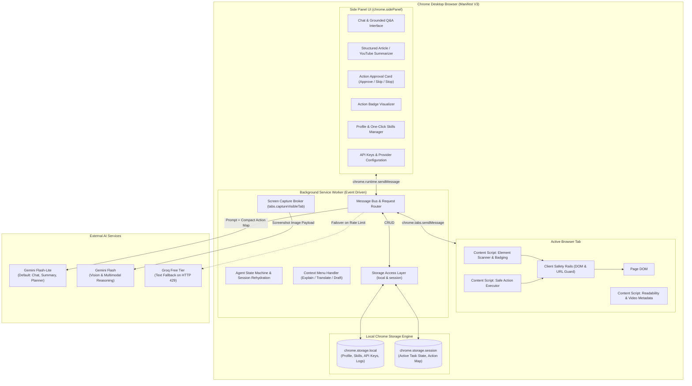
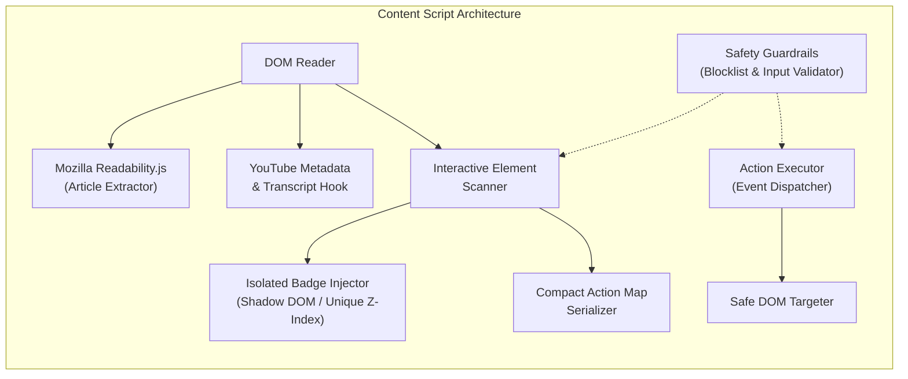
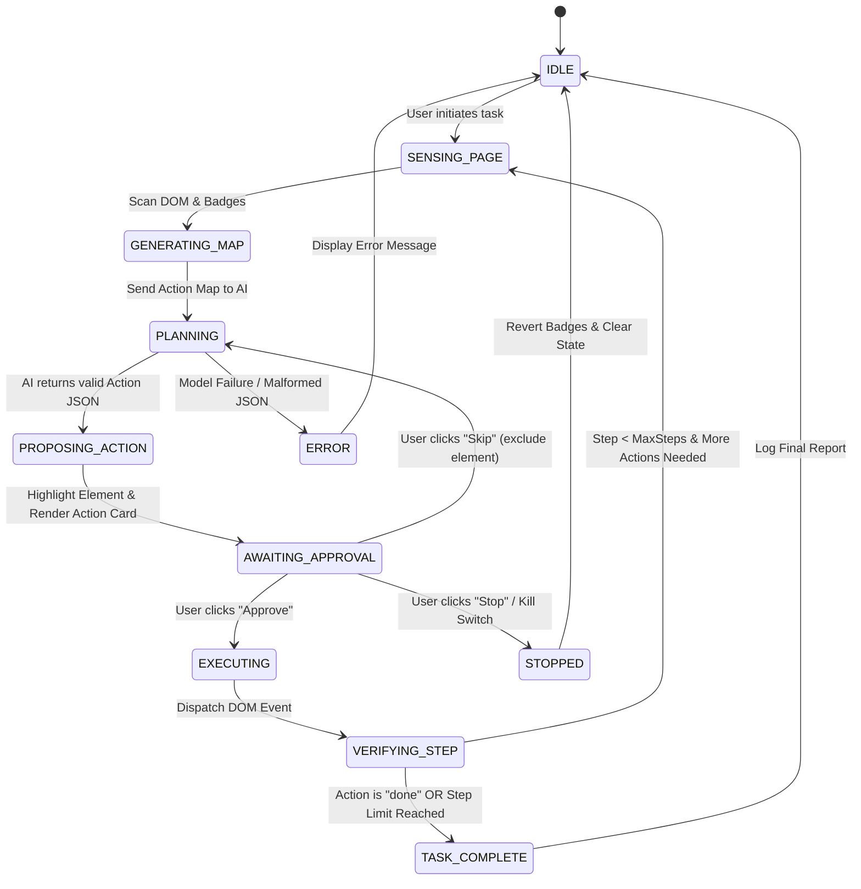
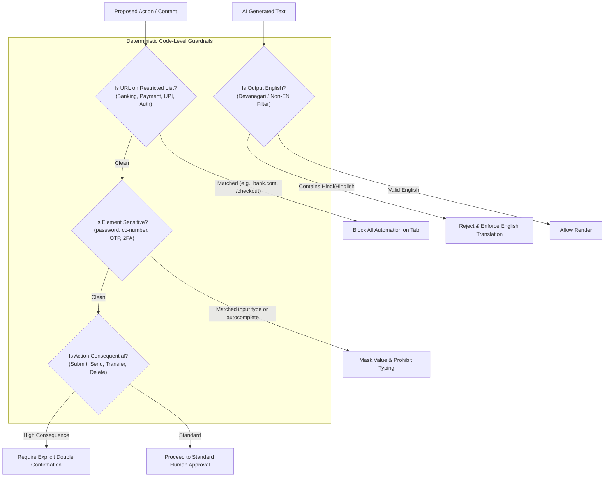
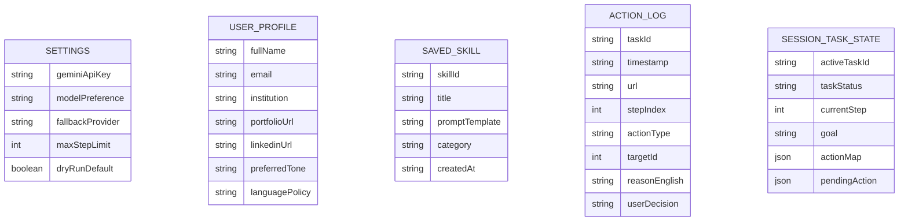

# Architecture Design Document: Sidekick — The Human-in-the-Loop Browser AI Agent

## 1. Executive Summary & Design Tenets

**Sidekick** is a privacy-first, human-in-the-loop Chrome side-panel AI agent built on Chrome Extension Manifest V3 (MV3). It bridges the gap between passive conversational assistants and autonomous browser automation by allowing users to understand web pages, ask grounded questions, inspect screen content, and safely perform browser actions with explicit human approval at every step.

### Core Architectural Tenets

1. **Human-in-the-Loop Primacy**: The agent operates on a strict *Sense $\rightarrow$ Propose $\rightarrow$ Approve $\rightarrow$ Act* loop. No browser mutation, click, navigation, or form submission occurs without explicit user verification.
2. **Strict English-Only Communication**: All outputs—summaries, answers, explanations, drafted replies, action reasons, and system alerts—are strictly enforced in English. The agent rejects Hindi, Hinglish, or any other output language at both the system prompt and code-filter levels.
3. **Deterministic Defense-in-Depth Safety**: Critical safety rails (blocking financial/banking domains, password fields, OTP inputs, and consequential buttons) are enforced deterministically in local JavaScript code, never deferred to probabilistic LLM judgment.
4. **Resilience on Free-Tier Stacks**: Built to operate reliably on free AI tiers (Google Gemini Flash-Lite / Flash, with Groq as an automated fallback), featuring automatic exponential backoff, rate-limit recovery (HTTP 429), and token-compact representations.
5. **Local Privacy by Default**: User profile data, saved skills, API keys, and action logs reside strictly on the user's machine via `chrome.storage.local`. No secondary telemetry or proxy servers exist.

---

## 2. System Architecture Overview

The following diagram illustrates the high-level architecture of Sidekick, detailing the communication pathways between the Chrome browser environment, extension subsystems, and AI providers.



---

## 3. Chrome Extension Manifest V3 Subsystems

### 3.1 Side Panel UI (`/src/sidepanel/`)

The Side Panel acts as the persistent user cockpit, operating within Chrome's native Side Panel API (`chrome.sidePanel`). It communicates asynchronously with the background service worker via typed messages.

#### Key UI Modules:
- **Cockpit Header**: Displays current tab title, agent execution status (`IDLE`, `PLANNING`, `AWAITING_APPROVAL`, `ACTING`), step counter (e.g., `Step 3/10`), and an **Immediate Stop / Kill Switch**.
- **Mode Views**:
  1. **Summarize View**: Displays article TL;DR, 5 key bullets, and next steps, or YouTube chapter timestamps. Includes a summary detail toggle (*Concise* vs. *Detailed*) and enforces strict English output.
  2. **Page Chat View**: Conversational interface with markdown rendering and live streaming of responses grounded exclusively in the page content.
  3. **Action Inspector View**: Active during agent tasks. Displays:
     - The target element number and type (e.g., `[#14 Button: "Next Step"]`).
     - Planned action (`click`, `type`, `select`, `scroll`).
     - Plain-English rationale generated by the AI planner.
     - Decision buttons: **Approve** (executes action), **Skip** (advances without acting), and **Stop** (terminates the loop).
     - Dry-run mode checkbox (highlights without clicking/typing).
  4. **Skills & Profile View**: Form inputs for local user profile variables (e.g., name, education, career links, preferred tone in English) and import/export of custom prompt recipes.
  5. **Settings View**: Secure input for Gemini API Key and fallback configurations with connection testing.

### 3.2 Background Service Worker (`/src/background/`)

Under Manifest V3, the service worker is ephemeral and will terminate during periods of inactivity (typically 30 seconds). The architecture solves this using a **State Rehydration Pattern**:

1. **Service Worker Termination Resilience**:
   - The active agent state (current task prompt, execution phase, step count, target action, and task history) is mirrored continuously in `chrome.storage.session`.
   - When awakened by a user click, context menu event, or storage change, the service worker immediately rehydrates the state machine from `chrome.storage.session` before processing events.
2. **Context Menu Dispatcher**:
   - Registers context menu items: `Explain Selection (English)`, `Translate to English`, and `Draft Reply (English)`.
   - Captures selected text and automatically opens the side panel while routing the prompt to the AI pipeline.
3. **Screen Capture Broker**:
   - Coordinates `chrome.tabs.captureVisibleTab(null, { format: 'png' })`.
   - Applies optional cropping parameters received from the content script region-selector, converting the resulting image into a base64 Data URL or raw Blob for multimodal Gemini consumption.

### 3.3 Content Script & In-Page Engine (`/src/content/`)

Content scripts are injected declaratively and dynamically via `chrome.scripting`. They isolate themselves from page scripts to prevent prototype pollution or page tampering.



#### Detailed Content Script Components:
- **Mozilla `Readability.js` Wrapper**:
  Clones the document DOM, extracts the primary readable article body, discards navigation, ads, headers, and footers, and returns a clean Markdown/text representation to the side panel.
- **YouTube Metadata & Transcript Extractor**:
  For YouTube URLs, extracts video title, channel, description, and available video timed-text cues directly from the player element or page metadata to allow instant chapter summaries without downloading video streams.
- **Interactive Element Scanner & Numbering Engine**:
  - Scans visible, non-obscured interactive elements: `<a>`, `<button>`, `<input>`, `<textarea>`, `<select>`, `[role="button"]`, `[role="checkbox"]`, and `[tabindex]`.
  - Assigns an ephemeral, stable 1-indexed number `badgeId` to each item for the current DOM state.
  - Generates a **Compact Action Map** formatted specifically for low-token LLM consumption:
    ```json
    [
      {"id": 1, "tag": "input", "type": "text", "name": "fullName", "label": "Full Name", "placeholder": "Enter your name"},
      {"id": 2, "tag": "input", "type": "email", "name": "email", "label": "Email Address"},
      {"id": 3, "tag": "button", "text": "Submit Application", "isConsequential": true}
    ]
    ```
- **Isolated Badge Injector**:
  - Injects badge overlays (`[ 1 ]`, `[ 2 ]`, etc.) directly over interactive elements using CSS `transform` coordinate overlays or an isolated shadow root to prevent page style contamination.
  - Automatically clears badges when tasks finish or pages navigate.
- **Safe Action Executor**:
  - Dispatches trusted-like browser events: `focus`, `click`, `change`, `input`, and `blur`.
  - Supports smooth scrolling into view (`scrollIntoView({ behavior: 'smooth', block: 'center' })`).
  - Supports dry-run execution: highlights the target element with a high-contrast pulsating border without triggering click or input events.

---

## 4. AI & LLM Processing Pipeline

### 4.1 Multi-Tier Model Routing & Free-Tier Resilience

To guarantee zero-cost operation and avoid quota lockouts, the AI pipeline incorporates an automated fallback controller:

```mermaid
flowchart TD
    Req[Incoming Task / Request] --> CheckVision{Requires Vision / Screenshot?}
    
    CheckVision -- Yes --> CallGeminiFlash[Call Gemini Flash\n(Multimodal)]
    CheckVision -- No --> CallGeminiLite[Call Gemini Flash-Lite\n(Everyday Default)]
    
    CallGeminiFlash --> CheckStatus1{Response Status}
    CallGeminiLite --> CheckStatus2{Response Status}
    
    CheckStatus1 -- 200 OK --> ValidateEN[Strict English Validator]
    CheckStatus2 -- 200 OK --> ValidateEN
    
    CheckStatus2 -- "429 Rate Limit\n(Quota Exceeded)" --> WaitRetry{Retries < 2?}
    WaitRetry -- Yes --> Backoff[Exponential Backoff Wait] --> CallGeminiLite
    WaitRetry -- No --> FallbackGroq[Fallback: Groq Free Tier API\n(Llama 3 / Mixtral)]
    
    FallbackGroq --> ValidateEN
    CheckStatus1 -- Error --> ShowFriendlyError[Display Friendly English Error]
    FallbackGroq -- Error --> ShowFriendlyError
    
    ValidateEN --> Success[Render to User / Send Action to Loop]
```

### 4.2 System Prompt Guardrails & Strict English Enforcement

Every call to the LLM injects a non-negotiable system prompt preamble enforcing English-only communication.

```
SYSTEM DIRECTIVE:
You are Sidekick, a secure, user-controlled browser AI agent.
LANGUAGE POLICY:
1. You MUST communicate, summarize, explain, reason, and draft exclusively in clear, professional English.
2. You must NEVER respond in Hindi, Hinglish, or any language other than English.
3. Even if the user prompt is written in another language, or the web page content is in Hindi or another language, you must process the meaning and provide your response ONLY in English.
4. If asked to translate text, translate it into English. Never translate into Hindi.
```

#### Code-Level Output Verifier:
Before any LLM response is rendered in the UI or passed to the agent executor, it passes through a regex and Unicode range checker:
- Scans for Devanagari Unicode blocks (`\u0900-\u097F`).
- If detected, the response is rejected before display, and an automatic re-prompt or client-side translation fallback is triggered to ensure zero Hindi leaks into the interface.

### 4.3 Structured Output Enforcement (Strict JSON Schema)

When Sidekick asks the model for browser navigation or form actions, it requests strict JSON format with schema adherence:

```json
{
  "$schema": "http://json-schema.org/draft-07/schema#",
  "type": "object",
  "properties": {
    "action": {
      "type": "string",
      "enum": ["click", "type", "select", "scroll", "done", "fail"]
    },
    "target_id": {
      "type": "integer",
      "description": "The element badge ID from the compact action map"
    },
    "value": {
      "type": "string",
      "description": "Text to type or option to select, if applicable"
    },
    "reason_en": {
      "type": "string",
      "description": "A concise, one-sentence plain English explanation of why this step is taken"
    }
  },
  "required": ["action", "reason_en"],
  "additionalProperties": false
}
```

The response is parsed using a strict `JSON.parse` with schema validation. If the model outputs malformed JSON or markdown backticks, a sanitizer extracts the JSON block before parsing.

---

## 5. Human-in-the-Loop Agent Loop & State Machine

The core browser automation is managed by an explicit, step-controlled finite state machine (FSM).



### Detailed Loop Step Lifecycle:
1. **Sensing Page**: Content script scans the current DOM state, filtering only visible elements within the active viewport or document.
2. **Generating Map**: Assigns badge IDs, renders non-intrusive badge labels, and compiles the serialized action map.
3. **Planning**: LLM receives the user goal, current URL, page summary, past action history, and compact action map, returning the single next logical step.
4. **Proposing Action**:
   - The targeted element is scrolled smoothly into view.
   - The element receives a glowing selection outline (dry-run preview).
   - An Action Proposal Card is presented in the side panel detailing:
     - Action type (`CLICK`, `TYPE`, `SELECT`, `SCROLL`).
     - Target element description.
     - Planned value (if typing).
     - Rationale in English.
5. **Human Approval Gate**:
   - **Approve**: Content script executes the exact event sequence.
   - **Skip**: The model is notified that this element was skipped and requested to propose an alternative.
   - **Stop**: The loop is terminated immediately; badge overlays and visual outlines are cleaned up.
6. **Step Limit Safeguard**: Every task has a default hard limit of 10 steps (configurable up to 20). When reached, execution pauses automatically to prevent infinite loops.

---

## 6. Deterministic Safety & Privacy Architecture

Safety is enforced through deterministic code barriers that execute before the AI ever sees an element or executes an action:



### Safety Rules Specification:

| Safety Category | Deterministic Enforcement Mechanism | Action Taken on Match |
| :--- | :--- | :--- |
| **Restricted Domains** | Regex match on `window.location.hostname` (`*bank*`, `*pay*`, `*upi*`, `*checkout*`, `*login*`) | Automation disabled; side panel alerts user that page is protected. |
| **Password Fields** | Selector match on `input[type="password"]` | Excluded entirely from the action map sent to AI; cannot be targeted. |
| **OTP & 2FA Fields** | Pattern match on name/id/placeholder: `otp`, `2fa`, `verification`, `security-code`, `code` | Blocked from automated typing. Must be entered manually by user. |
| **Credit Card Fields** | Matching `autocomplete="cc-number"`, `cc-exp`, `cc-csc`, `name="cardnumber"` | Strictly blocked from element map and execution. |
| **Consequential Buttons**| Text/ARIA match: `Submit`, `Place Order`, `Pay Now`, `Transfer`, `Delete Account` | Highlighted with high-alert warning in side panel; requires explicit confirmation checkbox before approval. |
| **Strict English Filter**| Unicode scan for non-Latin script ranges (`\u0900-\u097F` for Devanagari) | Strips/re-prompts output to prevent Hindi/Hinglish leakage. |
| **Emergency Stop** | Global shortcut (`Esc` key or prominent UI button) | Dispatches immediate abort signal to service worker and content script. |

---

## 7. Storage & Data Architecture

All persistence is local to the user's Chrome profile using `chrome.storage`:



### Storage Partitions:
1. **`chrome.storage.local`**:
   - `settings`: API keys and engine preferences.
   - `user_profile`: Local personal data for autofill.
   - `saved_skills`: Array of reusable prompt templates (can be exported/imported as `.json`).
   - `action_logs`: Rolling log of last 50 executed steps with user decisions.
2. **`chrome.storage.session`**:
   - Ephemeral memory wiped when Chrome closes.
   - Preserves `session_task_state` so agent execution survives background service worker sleep/wake cycles.

---

## 8. Inter-Component Messaging Protocol

All extension subsystems communicate over a strongly-typed message contract using `chrome.runtime.sendMessage` and `chrome.tabs.sendMessage`:

```typescript
// Shared Message Contract Definition
export type MessageType =
  // Side Panel <-> Service Worker
  | "INIT_TASK"
  | "APPROVE_ACTION"
  | "SKIP_ACTION"
  | "STOP_TASK"
  | "GET_ACTIVE_STATE"
  | "SUMMARIZE_PAGE"
  | "SUMMARIZE_YOUTUBE"
  | "GROUNDED_CHAT_QUERY"
  | "CAPTURE_SCREENSHOT"
  
  // Service Worker <-> Content Script
  | "SCAN_ELEMENTS"
  | "HIGHLIGHT_ELEMENT"
  | "EXECUTE_ACTION"
  | "CLEAR_BADGES"
  | "EXTRACT_ARTICLE"
  | "EXTRACT_YOUTUBE_METADATA";

export interface ExtensionMessage<T = any> {
  type: MessageType;
  payload: T;
  correlationId: string;
  sender: "sidepanel" | "background" | "content";
  timestamp: number;
}
```

### Message Routing Flow Example (Action Execution):
1. **Side Panel** sends `APPROVE_ACTION` with `target_id` and `action` to **Service Worker**.
2. **Service Worker** logs approval in `chrome.storage.session` and forwards `EXECUTE_ACTION` to **Content Script** of the active tab.
3. **Content Script** checks deterministic safety rails $\rightarrow$ executes DOM event sequence $\rightarrow$ returns `{ success: true, newUrl: string }`.
4. **Service Worker** updates step count and triggers next `SCAN_ELEMENTS` cycle.

---

## 9. Project Directory Structure

```
sidekick-extension/
├── manifest.json                 # Manifest V3 configuration
├── icons/                        # Extension icons (16, 32, 48, 128px)
├── src/
│   ├── background/
│   │   ├── service_worker.js     # Background coordinator & lifecycle manager
│   │   ├── context_menus.js      # Right-click menu registrations
│   │   ├── state_manager.js      # Task session persistence & rehydration
│   │   └── capture_broker.js     # Tab screen capture handler
│   ├── content/
│   │   ├── content_script.js     # In-page coordinator
│   │   ├── readability.js        # Mozilla Readability.js distribution
│   │   ├── youtube_extractor.js  # YouTube metadata & transcript parser
│   │   ├── scanner.js            # Interactive element detector
│   │   ├── badging.js            # Non-intrusive badge overlay renderer
│   │   ├── executor.js           # Safe synthetic event dispatcher
│   │   └── safety_guard.js       # Deterministic URL and input blocklists
│   ├── sidepanel/
│   │   ├── sidepanel.html        # Main side-panel markup
│   │   ├── sidepanel.css         # Modern, responsive theme & component styling
│   │   ├── sidepanel.js          # UI controller & message bridge
│   │   ├── components/
│   │   │   ├── chat_view.js      # Grounded page chat & stream renderer
│   │   │   ├── summary_view.js   # Article & YouTube structured summary card
│   │   │   ├── action_card.js    # Step proposal & Approve/Skip/Stop controls
│   │   │   ├── profile_view.js   # Local memory profile manager
│   │   │   └── skills_view.js    # One-click reusable skill manager
│   ├── ai/
│   │   ├── provider_router.js    # Routing logic (Gemini Lite vs Flash vs Groq)
│   │   ├── gemini_client.js      # Google AI Studio Gemini API client
│   │   ├── groq_client.js        # Groq API fallback client
│   │   ├── prompt_templates.js   # Grounded prompts with strict English directives
│   │   └── response_validator.js # JSON schema and English Unicode validator
│   ├── shared/
│   │   ├── types.js              # Message and schema constants
│   │   ├── storage_utils.js      # Typed helpers for chrome.storage
│   │   └── logger.js             # Formatted action and debug logger
├── docs/
│   ├── problem_statement.md      # Ground-truth project specifications
│   ├── architecture.md           # This document
│   ├── implementation_plan.md    # Phase-by-phase implementation plan
│   └── edge_cases.md             # Edge case & mitigation directory
└── README.md                     # Installation, setup, and usage documentation
```

---

## 10. Summary of Architectural Guarantees

1. **Security**: Hardcoded safety rails guarantee no password, OTP, or credit card values can ever be read, typed, or sent to an LLM.
2. **Predictability**: No autonomous multi-step execution. Every individual DOM interaction requires an explicit user approval click.
3. **Language Consistency**: The agent is architecturally locked to English-only responses across prompts, schemas, and output validation filters.
4. **Reliability**: Dual-model routing with automatic rate-limit fallback ensures the extension continues functioning on free-tier APIs without sudden crashes.
5. **Installability**: Built standard-compliant for Manifest V3, allowing simple one-click loading via Chrome's "Load unpacked" mode.
