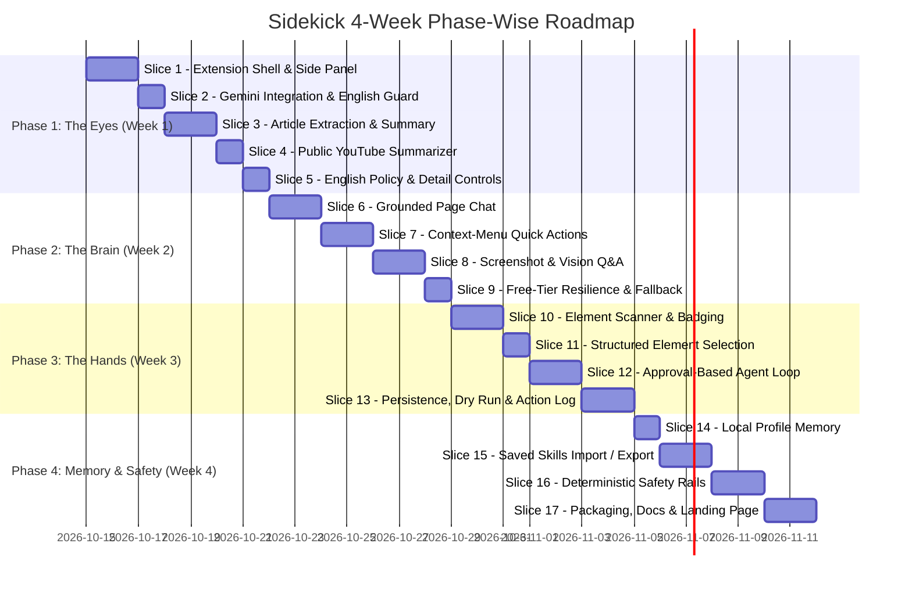

# Phase-Wise Implementation Plan: Sidekick — The Human-in-the-Loop Browser AI Agent

This document defines the actionable, vertical-slice implementation plan for building **Sidekick**, mapping directly to the specifications in [`problem_statement.md`](file:///c:/Users/AaronFrancis/Desktop/vscode/research/AI_agent_workshop/october%20cohort/docs/problem_statement.md) and the system architecture in [`architecture.md`](file:///c:/Users/AaronFrancis/Desktop/vscode/research/AI_agent_workshop/october%20cohort/docs/architecture.md).

---

## Environment & Tooling Requirement

> [!IMPORTANT]
> ### Dedicated Virtual Environment
> For all installations, tooling, mock test servers, automation harnesses, build/packaging scripts, and dependencies across this project, you **MUST** use the existing dedicated virtual environment located at:
> 
> **`C:\Users\AaronFrancis\Desktop\vscode\.venv`**
> 
> - **PowerShell Activation**:
>   ```powershell
>   & "C:\Users\AaronFrancis\Desktop\vscode\.venv\Scripts\Activate.ps1"
>   ```
> - **Python Interpreter**:
>   `C:\Users\AaronFrancis\Desktop\vscode\.venv\Scripts\python.exe`
> - **Pip Package Manager**:
>   `C:\Users\AaronFrancis\Desktop\vscode\.venv\Scripts\pip.exe`
>
> **Rules:**
> 1. Never create or initialize a secondary or nested virtual environment.
> 2. Whenever Python scripts or local testing servers (e.g., mock practice test forms, local HTTP static test fixtures) are run, execute them explicitly with this Python environment.
> 3. Any additional developer tools, formatters, or test utilities requiring `pip install` must be installed into this `.venv`.

---

## Roadmap Overview (4 Weeks / 4 Phases / 17 Vertical Slices)



---

## Phase 1: The Eyes — Read the Web (Week 1)

**Phase Objective**: Establish the Chrome Extension Manifest V3 foundation, wire the Side Panel UI, connect the Gemini API, and implement article and YouTube summarisation strictly in English.

---

### Slice 1: Extension Shell, Side Panel & Settings
- **Goal**: Create a loadable Chrome Manifest V3 extension with an accessible side panel and persistent settings for credentials.
- **Environment**: Use `C:\Users\AaronFrancis\Desktop\vscode\.venv` for any local development server or fixture runner.
- **File Deliverables**:
  - `manifest.json`: Declare MV3, permissions (`sidePanel`, `storage`, `activeTab`, `scripting`), and `default_path: "src/sidepanel/sidepanel.html"`.
  - `src/background/service_worker.js`: Basic background script that opens the side panel on extension icon click (`chrome.sidePanel.setPanelBehavior`).
  - `src/sidepanel/sidepanel.html`: Core tabbed layout (Chat, Summary, Inspector, Profile, Settings).
  - `src/sidepanel/sidepanel.css`: Modern, clean styling with sleek dark/light mode tokens.
  - `src/sidepanel/sidepanel.js`: Navigation tab-switching logic and settings form handler.
  - `src/shared/storage_utils.js`: Helpers for reading/writing API keys to `chrome.storage.local`.
- **Verification Criteria**:
  - Extension loads without errors in `chrome://extensions/` via **Load unpacked**.
  - Clicking the extension icon opens the side panel next to any standard website.
  - User can enter their Google AI Studio Gemini API key in Settings, save it, and reload without losing the key.

---

### Slice 2: Gemini API Integration & Strict English Guardrail
- **Goal**: Build the client for calling Gemini Flash-Lite with hardcoded English system prompt directives.
- **File Deliverables**:
  - `src/ai/gemini_client.js`: HTTP fetch client targeting Google AI Studio REST endpoints (`gemini-2.0-flash-lite` or equivalent). Handles streaming and non-streaming responses.
  - `src/ai/prompt_templates.js`: Reusable system prompts containing the mandatory English-only directive:
    ```
    You are Sidekick. You MUST communicate and summarize exclusively in English.
    Under NO circumstance should you output Hindi, Hinglish, or any other language.
    ```
  - `src/ai/response_validator.js`: Regex validator checking for Devanagari Unicode (`[\u0900-\u097F]`). Rejects and retries if detected.
- **Verification Criteria**:
  - A test prompt sent from the side panel receives a valid streamed response from the Gemini API.
  - If a user sends a query in Hindi, the response is delivered strictly in English.

---

### Slice 3: Article Content Extraction & Structured Summary
- **Goal**: Extract clutter-free article text using `Readability.js` and generate structured English summaries.
- **File Deliverables**:
  - `src/content/readability.js`: Bundled Mozilla `Readability.js` script.
  - `src/content/content_script.js`: Injected script that instantiates `Readability` on a cloned DOM document and returns `{ title, byline, content, textContent }`.
  - `src/sidepanel/components/summary_view.js`: UI component displaying:
    - **One-line TL;DR**
    - **5 Key Takeaways** (bulleted)
    - **What to do next** (action items)
    - Copy-to-clipboard button.
- **Verification Criteria**:
  - Open a long blog post (e.g., TechCrunch, Medium, Wikipedia).
  - Clicking "Summarize Page" extracts the article without ads, navigation, or footers.
  - The structured summary renders accurately in under 3 seconds in strict English.

---

### Slice 4: Public YouTube Summarizer
- **Goal**: Detect YouTube watch pages, extract video metadata and transcript/cues, and generate structured chapter-style summaries.
- **File Deliverables**:
  - `src/content/youtube_extractor.js`: Reads YouTube player metadata (video title, channel, description, and timed subtitle text if accessible via DOM).
  - `src/sidepanel/components/summary_view.js`: Extended to display timestamped key moments (e.g., `01:45 - Key Point`). Clicking a timestamp seeks the video to that moment via `chrome.tabs.sendMessage`.
- **Verification Criteria**:
  - Open any public YouTube video with captions.
  - The Sidekick summarizer generates chronological chapter summaries in English.
  - Clicking `02:30` in the summary updates the active YouTube player to 2 minutes 30 seconds.

---

### Slice 5: English-Only Policy Enforcement & Summary Controls
- **Goal**: Ensure robust English-only enforcement and provide response format controls (Concise vs. Detailed).
- **File Deliverables**:
  - `src/sidepanel/sidepanel.html`: Add toggle buttons: `[Concise]` vs `[Detailed]`.
  - `src/ai/prompt_templates.js`: Inject formatting parameters into the prompt while keeping language strictly locked to English.
  - Code-level guardrail in `src/ai/response_validator.js` preventing any non-English generation.
- **Verification Criteria**:
  - Switching between *Concise* (3-sentence summary) and *Detailed* (exhaustive breakdown) produces appropriately sized English summaries.
  - Non-English pages (e.g., French, Spanish, Hindi news sites) are summarized purely in fluent English.

---

## Phase 2: The Brain — Understand the Page & Screen (Week 2)

**Phase Objective**: Provide contextual understanding through grounded in-page chat, right-click context menu shortcuts, visual screen inspection, and free-tier rate-limit resilience.

---

### Slice 6: Grounded Page Chat Interface
- **Goal**: Build a streaming chat interface where responses are strictly anchored in current page content.
- **File Deliverables**:
  - `src/sidepanel/components/chat_view.js`: Chat interface with message bubble history, markdown rendering, code block copy, and streaming cursor.
  - `src/ai/prompt_templates.js`: Grounded Q&A prompt template instructing the model:
    - Answer using *only* the provided page context.
    - If the page does not contain the answer, explicitly state: *"This page does not contain that information."* in English.
    - Avoid external hallucinations.
- **Verification Criteria**:
  - Ask questions about specific terms on the page; assistant gives accurate page-grounded answers in English.
  - Ask an unrelated question (e.g., *"What is the capital of France?"* on a cooking blog); the assistant responds that the current page does not mention that.

---

### Slice 7: Context-Menu Quick Actions
- **Goal**: Add right-click browser context menus for selected text that send requests directly to Sidekick.
- **File Deliverables**:
  - `src/background/context_menus.js`: Registers menu items using `chrome.contextMenus.create`:
    - `Sidekick: Explain this in plain English`
    - `Sidekick: Translate to English`
    - `Sidekick: Draft a professional reply`
  - Integration with `service_worker.js`: Automatically opens the side panel (`chrome.sidePanel.open`), focuses the active tab, and pipes the result into the chat view.
- **Verification Criteria**:
  - Highlight text on any page $\rightarrow$ Right click $\rightarrow$ Select `Sidekick: Explain this`.
  - The side panel opens and streams a simplified explanation in plain English.
  - Selecting non-English text and clicking `Translate to English` outputs clean English (never translates into Hindi).

---

### Slice 8: Screenshot Capture & Multimodal Visual Q&A
- **Goal**: Allow users to capture visible tab contents and ask visual questions (diagrams, charts, tables) using Gemini Flash.
- **File Deliverables**:
  - `src/background/capture_broker.js`: Calls `chrome.tabs.captureVisibleTab(null, { format: 'png' })`.
  - `src/content/region_selector.js`: Lightweight canvas overlay that lets the user drag-and-drop a rectangular crop box over a visual element.
  - `src/sidepanel/components/chat_view.js`: Shows thumbnail preview of the captured screenshot in chat.
  - `src/ai/gemini_client.js`: Multimodal payload builder attaching base64 image data to the Gemini Flash endpoint.
- **Verification Criteria**:
  - Capture an infographic or bar chart on a webpage.
  - Ask: *"What is the trend shown in this chart?"*
  - Sidekick accurately analyzes the visual content and answers in English.

---

### Slice 9: Free-Tier Resilience & Fallback Engine
- **Goal**: Gracefully handle API rate limits (HTTP 429) using exponential backoff and automatic failover to the Groq free tier.
- **File Deliverables**:
  - `src/ai/provider_router.js`: Fallback controller. If Gemini returns `429 Too Many Requests` or quota exhausted:
    1. Pauses with exponential backoff (1s, 2s) and retries once.
    2. If still throttled, falls back to Groq free-tier endpoint (`llama-3.3-70b-versatile` or `mixtral-8x7b`).
  - `src/ai/groq_client.js`: OpenAI-compatible fetch client for Groq API.
  - `src/sidepanel/sidepanel.js`: Renders non-intrusive warning badges (e.g., *"Operating on Groq fallback due to Gemini rate limit"*).
- **Verification Criteria**:
  - Simulate a 429 response: system seamlessly fails over to Groq without throwing uncaught exceptions or crashing the side panel.
  - Displays user-friendly error banners if all providers are exhausted.

---

## Phase 3: The Hands — Act With User Approval (Week 3)

**Phase Objective**: Implement the interactive element scanner, numbered badge overlay, action proposal cards, and the step-by-step human-in-the-loop agent loop.

---

### Slice 10: Interactive Element Scanner & Isolated Badging
- **Goal**: Scan the active DOM for actionable elements and render non-intrusive numbered badges over them.
- **File Deliverables**:
  - `src/content/scanner.js`: Traverses visible DOM elements (`a`, `button`, `input`, `select`, `textarea`, `[role="button"]`, etc.). Excludes hidden/zero-size items. Assigns incremental numeric IDs (`badgeId: 1, 2, 3...`).
  - `src/content/badging.js`: Renders numbered floating badges directly over elements using fixed/absolute coordinates or Shadow DOM overlay. Includes a toggle to show/hide badges.
  - `src/content/map_serializer.js`: Converts scanned elements into a compact JSON action map for the LLM.
- **Verification Criteria**:
  - Trigger "Scan Page": visible interactive elements receive high-contrast numbered badges (`[1]`, `[2]`, etc.).
  - Badges do not break existing page CSS or element clickability.
  - Generated action map is compact (under 2,000 tokens for a standard form).

---

### Slice 11: Structured Element Selection ("Find It for Me")
- **Goal**: Allow users to query page elements in natural language, having Sidekick identify and highlight the target element without acting.
- **File Deliverables**:
  - `src/sidepanel/components/action_card.js`: "Find element" input.
  - `src/ai/prompt_templates.js`: Element locator prompt returning strict JSON `{ target_id: number, reason_en: string }`.
  - `src/content/executor.js`: Smoothly scrolls the target element to the viewport center and applies a pulsating high-contrast ring outline.
- **Verification Criteria**:
  - On a job portal or practice form, ask: *"Where do I upload my resume?"*
  - Sidekick identifies badge `#8 (input type='file')`, scrolls to it, and pulses it without clicking.

---

### Slice 12: Approval-Based Agent Loop (Sense $\rightarrow$ Propose $\rightarrow$ Approve $\rightarrow$ Act)
- **Goal**: Implement the core agent loop where the AI proposes one action at a time and executes only after explicit human approval.
- **File Deliverables**:
  - `src/background/state_manager.js`: FSM coordinator managing task states (`IDLE`, `PLANNING`, `AWAITING_APPROVAL`, `EXECUTING`, `STOPPED`).
  - `src/sidepanel/components/action_card.js`:
    - Renders the proposed action: Type (`click`, `type`, `select`, `scroll`, `done`), target element details, input text, and English reason.
    - Interactive buttons: **Approve** (executes action), **Skip** (asks for alternative), **Stop** (kills task).
  - `src/content/executor.js`: Synthetic event dispatcher simulating trusted user actions (`focus`, `input`, `click`, `change`, `blur`).
- **Verification Criteria**:
  - Give Sidekick a goal: *"Fill the first name field with Aaron"*.
  - Sidekick proposes: `Type "Aaron" into Element #3 (First Name)`.
  - Action is **NOT** executed until user clicks "Approve".
  - Clicking "Approve" types the value into the field and advances the loop.

---

### Slice 13: Loop Persistence, Dry-Run Mode & Action Audit Log
- **Goal**: Make the agent loop resilient to service-worker sleep, add dry-run preview, and maintain an audit log.
- **File Deliverables**:
  - `src/background/state_manager.js`: Mirrors active loop state into `chrome.storage.session`. Rehydrates seamlessly if service worker wakes from idle.
  - `src/content/executor.js`: Dry-run mode: highlights intended target without dispatching DOM mutation events.
  - `src/sidepanel/components/action_card.js`: Max step limit safety check (default: 10 steps max).
  - `src/sidepanel/components/log_view.js`: Collapsible action log displaying all proposed actions, English rationale, timestamps, and user decisions (*Approved* / *Skipped*).
- **Verification Criteria**:
  - Agent survives manual service worker restart via `chrome://extensions/` while waiting for approval.
  - With "Dry-Run" enabled, approved actions highlight elements without submitting or modifying inputs.
  - Audit log accurately reflects all completed and skipped steps.

---

## Phase 4: Memory, Safety & Shipping (Week 4)

**Phase Objective**: Add local user profile memory, reusable prompt skills, hardcoded deterministic safety rails, and prepare release packaging.

---

### Slice 14: Local Profile Memory
- **Goal**: Store user details locally to enable automatic form autofill and customized drafts without transmitting data to third parties.
- **File Deliverables**:
  - `src/sidepanel/components/profile_view.js`: Form for local attributes:
    - Full Name, Email, University/Institution, Portfolio URL, LinkedIn URL.
    - Preferred English tone (e.g., *Professional*, *Concise*, *Casual*).
  - `src/shared/storage_utils.js`: Saves profile data exclusively to `chrome.storage.local`.
  - Integration with planner: When filling forms, Sidekick checks local profile data to populate fields.
- **Verification Criteria**:
  - Save profile with name, email, and LinkedIn link.
  - Give task: *"Fill this job application form using my profile"*.
  - Sidekick proposes actions matching the saved local profile data.

---

### Slice 15: One-Click Reusable Skills (Import / Export)
- **Goal**: Enable users to save, run, export, and import modular prompt recipes for common tasks.
- **File Deliverables**:
  - `src/sidepanel/components/skills_view.js`: List of pre-installed and custom skills:
    1. *Exam Notes* (Generates structured English revision bullet points).
    2. *Explain in Plain English (ELI5)*.
    3. *Polite Email Reply* (Drafts a professional response).
    4. *Fill Form from Profile*.
  - JSON import/export handler allowing users to backup or share skills (`skills.json`).
- **Verification Criteria**:
  - Clicking "Exam Notes" on any article generates revision notes instantly.
  - Exporting skills downloads a valid JSON file; importing that file restores custom prompt recipes.

---

### Slice 16: Deterministic Safety Rails & Guardrail Verification
- **Goal**: Implement hardcoded, deterministic client-side safety checks that block risky pages and fields before any LLM execution.
- **File Deliverables**:
  - `src/content/safety_guard.js`:
    - **Restricted URL Blocker**: Blocks actions on banking, payment, checkout, and auth domains (`*bank*`, `*pay*`, `*checkout*`, `*upi*`, `*login*`).
    - **Protected Field Filter**: Completely strips `input[type="password"]`, credit card fields, and OTP/2FA inputs from the action map.
    - **High-Consequence Action Check**: Detects buttons containing *Submit*, *Pay*, *Send*, *Delete*. Requires a dedicated warning checkbox before the "Approve" button becomes active.
    - **Emergency Kill Switch**: Pressing `Esc` or clicking "STOP" dispatches immediate task abort.
- **Verification Criteria**:
  - Navigate to a checkout or password page: Sidekick displays a safety shield banner stating automation is restricted on sensitive pages.
  - Sensitive password/credit card inputs are never numbered or submitted to the model.

---

### Slice 17: Packaging, Release Build & Landing Page
- **Goal**: Polish documentation, create a production release ZIP, and set up a GitHub Pages landing site.
- **Environment**: For any packaging scripts, test runners, or HTML generators, run via:
  `& "C:\Users\AaronFrancis\Desktop\vscode\.venv\Scripts\python.exe"`
- **File Deliverables**:
  - `README.md`: High-quality project README featuring setup instructions, architecture overview, architecture diagram, and feature screenshots.
  - `dist/sidekick-v1.0.0.zip`: Clean, unpacked installable bundle with unnecessary dev artifacts removed.
  - `docs/index.html`: Lightweight, modern one-page landing site for GitHub Pages showing demo animations and install steps.
- **Verification Criteria**:
  - A clean installation test: Download the ZIP on a fresh Chrome profile, extract, load unpacked, input an API key, and successfully execute all acceptance criteria end-to-end.

---

## Detailed Task & Dependency Matrix

| Slice # | Slice Name | Dependencies | Primary Files Modified / Created | Target Completion |
| :--- | :--- | :--- | :--- | :--- |
| **01** | Extension Shell & Side Panel | None | `manifest.json`, `src/sidepanel/*`, `src/background/*` | Day 2 |
| **02** | Gemini API & English Guard | Slice 01 | `src/ai/gemini_client.js`, `src/ai/prompt_templates.js` | Day 3 |
| **03** | Article Extraction & Summary | Slice 02 | `src/content/readability.js`, `src/content/content_script.js` | Day 5 |
| **04** | YouTube Summarizer | Slice 03 | `src/content/youtube_extractor.js`, `src/sidepanel/summary_view.js` | Day 6 |
| **05** | English Policy & Controls | Slice 02, 03 | `src/ai/response_validator.js`, `src/sidepanel/sidepanel.html` | Day 7 |
| **06** | Grounded Page Chat | Slice 03, 05 | `src/sidepanel/components/chat_view.js` | Day 9 |
| **07** | Context-Menu Quick Actions | Slice 01, 06 | `src/background/context_menus.js` | Day 11 |
| **08** | Screenshot & Multimodal Q&A | Slice 01, 06 | `src/background/capture_broker.js`, `src/content/region_selector.js`| Day 13 |
| **09** | Free-Tier Resilience & Fallback| Slice 02, 06 | `src/ai/provider_router.js`, `src/ai/groq_client.js` | Day 14 |
| **10** | Element Scanner & Badges | Slice 01 | `src/content/scanner.js`, `src/content/badging.js` | Day 16 |
| **11** | Structured Element Selection | Slice 10 | `src/sidepanel/components/action_card.js`, `src/content/executor.js`| Day 17 |
| **12** | Approval-Based Agent Loop | Slice 10, 11 | `src/background/state_manager.js`, `src/content/executor.js` | Day 19 |
| **13** | Persistence & Audit Log | Slice 12 | `src/background/state_manager.js`, `src/sidepanel/log_view.js` | Day 21 |
| **14** | Local Profile Memory | Slice 01, 12 | `src/sidepanel/profile_view.js`, `src/shared/storage_utils.js` | Day 22 |
| **15** | Saved Skills Import / Export | Slice 14 | `src/sidepanel/skills_view.js` | Day 24 |
| **16** | Deterministic Safety Rails | Slice 10, 12 | `src/content/safety_guard.js` | Day 26 |
| **17** | Packaging, Docs & Landing Page| All | `README.md`, `docs/index.html`, `dist/sidekick-v1.0.0.zip` | Day 28 |

---

## Acceptance Test Protocol (Definition of Done Verification)

Before declaring the project complete, the following end-to-end user journey must pass without regressions:

1. **Clean Installation**: Install from `dist/sidekick-v1.0.0.zip` via Chrome *Load unpacked*.
2. **API Setup**: Input Gemini API Key in Settings view; test connection returns success.
3. **Article Summary**: Open a long article; click "Summarize Page"; verify structured output (TL;DR, 5 points, next steps) in pure English.
4. **YouTube Summary**: Open a public YouTube video; verify timestamped chapter summaries in English; click timestamp to seek.
5. **English Enforcement**: Submit queries with multilingual or Hindi prompts; verify response is delivered strictly in English.
6. **Grounded Chat**: Ask questions about the page; verify answers strictly use page context and refuse to hallucinate unlisted data.
7. **Context Menu**: Highlight text $\rightarrow$ Select `Explain this` and `Translate to English` $\rightarrow$ Verify clean English outputs in side panel.
8. **Screenshot Inspection**: Select visual screen region with chart/diagram $\rightarrow$ Ask question $\rightarrow$ Receive visual analysis in English.
9. **Interactive Badging**: Click "Scan Page" on a multi-input form $\rightarrow$ Verify numbered badges appear cleanly over inputs/buttons.
10. **Find Element**: Ask *"Where do I submit?"* $\rightarrow$ Verify target button is highlighted and scrolled to without clicking.
11. **Approval Loop**: Trigger a multi-step task $\rightarrow$ Verify each step proposes action, element, and English reason $\rightarrow$ Action only executes upon clicking "Approve".
12. **Safety Rail Verification**:
    - Open a simulated bank/checkout URL $\rightarrow$ Automation blocked.
    - Form with password/OTP field $\rightarrow$ Sensitive fields excluded from action map.
    - Consequential *Submit* button $\rightarrow$ Requires additional confirmation checkbox.
13. **Local Profile Autofill**: Load saved profile $\rightarrow$ Verify form inputs populated accurately.
14. **Skills Management**: Run a saved skill $\rightarrow$ Export skills to JSON $\rightarrow$ Re-import on fresh browser profile.
